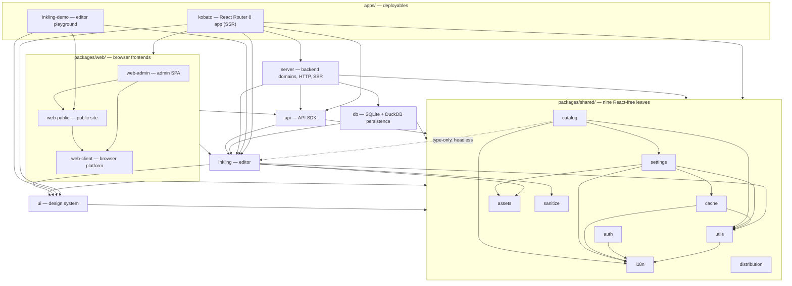

# Workspace architecture

This page is the one-page map of the Kobato workspace: what every package is responsible for, which way the dependencies
point, and how the pieces fit together when you add an endpoint. It describes the current state — the authoritative
per-package contracts live in each package's `AGENTS.md`, and the graph itself is pinned by
[apps/kobato/tests/arch/package-dag.test.ts](../apps/kobato/tests/arch/package-dag.test.ts).

For the external-consumer story (which RPC groups carry a stability guarantee, deployment topologies), see
[ADR-0009](adr/0009-optional-headless-frontends.md).

## The dependency graph

Four top-level roots, one direction of flow: `apps/` deploy the product, `packages/` hold all shipping code, `tools/`
and `scripts/` are dev support only.



How to read it:

- Every arrow is also the enforcement: the declared-allowlist, the per-file import scan, and the web direction are all
  pinned in `apps/kobato/tests/arch/` (`package-dag`, `web-direction`, `server-layers`, `admin-feature-graph`,
  `server-public-surface`, `module-cycles`).
- An edge into the shared umbrella means "depends on the leaves it declares" — each package declares exactly the leaves
  it imports, never the whole set. `@kobato/i18n`, `@kobato/distribution`, `@kobato/assets`, and `@kobato/sanitize` have
  no leaf dependencies of their own.
- Inkling is reached through its entry surfaces only: `server`, `db`, and `api` import the React-free `/headless*`
  modules; `catalog` imports them type-only; `web-admin` uses the headless modules, the React barrel, and `/host-cards`;
  `web-public` uses the headless modules and the React barrel; `web-client` uses the barrel. The app imports no Inkling
  TypeScript module — its editor surfaces come from the web leaves — but its style entries
  (`apps/kobato/src/styles/{public,admin}.css`) compose `@kobato/inkling/styles/cards.css`. The playground uses the
  public entries.
- `web-admin` declares `@kobato/server` as a tests-only fixture dependency — its production sources never import the
  server.

Key external libraries and their primary production homes. The table states ownership, not an exhaustive import
inventory — test trees, build-config strings, and erased type-only references sit outside it; actual imports stay
constrained by the package DAG:

| Library                                             | Home                                                                                                                                                                                                                                           |
| --------------------------------------------------- | ---------------------------------------------------------------------------------------------------------------------------------------------------------------------------------------------------------------------------------------------- |
| Zod                                                 | Ubiquitous; the wire vocabulary lives in `@kobato/api/contracts`                                                                                                                                                                               |
| `@orpc/contract`                                    | `@kobato/api` — procedure metadata in `rpc/`, the client transport in `client/`; `src/contracts/` imports no `@orpc/*`                                                                                                                         |
| `@orpc/server`                                      | `@kobato/server` — the `implement{Public,Authed,Author,Admin}` bases and router mounting in `http/`                                                                                                                                            |
| `@orpc/client`                                      | `@kobato/api/client` — the production link assembly every caller shares (the factory)                                                                                                                                                          |
| `@orpc/react-query`                                 | `@kobato/web-client` — the React Query seam; the SDK stays React-free                                                                                                                                                                          |
| Hono                                                | `@kobato/server` — the HTTP perimeter                                                                                                                                                                                                          |
| React Router 8                                      | The app's routes and `meta` export; runtime use across the web leaves (`Link`, hooks) and the server's SSR perimeter (`createSsrCaller`); its `MetaDescriptor` type shapes catalog's SEO/listing models and through them the listing wire DTOs |
| Lexical                                             | `@kobato/inkling` — the editor owns the Lexical runtime; consumers reach it through inkling's entry surfaces                                                                                                                                   |
| Drizzle + `node:sqlite`                             | `@kobato/db` — content DB schema, rows, migrations                                                                                                                                                                                             |
| DuckDB (`@duckdb/node-api`) + Kysely (compile-only) | The engine handle and dashboard queries in `@kobato/db`; Kysely is the compile-only SQL builder for analytics queries (db and the server's analytics services, executed through the db seam)                                                   |

## Package responsibilities

Product packages (`apps/` + `packages/`) — every one has a package-root `AGENTS.md` with the full contract:

| Package              | Responsibility                                                                                                                                                                                                                   |
| -------------------- | -------------------------------------------------------------------------------------------------------------------------------------------------------------------------------------------------------------------------------- |
| `apps/kobato`        | The deployable React Router 8 Framework Mode app (SSR): framework entry set, the four route trees, the typed route-meta/SEO factory. Routes extract request context, call orchestrators, render — the app owns nothing reusable. |
| `apps/inkling-demo`  | Standalone Inkling playground (`pnpm demo`); not part of the product build.                                                                                                                                                      |
| `@kobato/api`        | The API SDK — wire Zod schemas + DTOs (`contracts/`), oRPC procedure metadata (`rpc/`), the contract composition root, and the React-free client factory + wire-error decoding (`client/`).                                      |
| `@kobato/server`     | The backend — six one-way source roots (`bootstrap/`, `infra/`, `domains/`, `http/`, `render/`, `assets/`): business domains, the oRPC + Hono perimeter, SSR output products (HTML, feeds, OG, SEO), sessions, jobs, backup.     |
| `@kobato/db`         | Persistence — the SQLite content database (node:sqlite + Drizzle: schema, row types, queries, migrations) and the DuckDB analytics sidecar's persistence layer (DDL, appends, dashboard queries).                                |
| `@kobato/ui`         | The design system — tokens, base styles, shadcn/Base UI primitives, icons, theme/i18n providers, generic presentation hooks, the music-player family.                                                                            |
| `@kobato/inkling`    | The Lexical rich-text editor — React runtime and host cards; the document model ships React-free under `/headless`.                                                                                                              |
| `@kobato/web-admin`  | The admin frontend leaf — admin components, domain controllers, the page-editor composition.                                                                                                                                     |
| `@kobato/web-public` | The public frontend leaf — public chrome, the comment thread, post-body projection and hydration, widgets, the friends grid.                                                                                                     |
| `@kobato/web-client` | The browser platform under both leaves — document-level hooks, the oRPC browser client assembly (same-origin URL, CSRF store), root settings contexts, React Query wrappers, the cross-surface editor platform, the RUM client.  |

The nine shared leaves (`packages/shared/`) — runtime-isomorphic and React-free, imported module-direct with no barrels:

| Leaf                   | Responsibility                                                                                                                                                            |
| ---------------------- | ------------------------------------------------------------------------------------------------------------------------------------------------------------------------- |
| `@kobato/utils`        | Pure isomorphic helpers + display formatting.                                                                                                                             |
| `@kobato/i18n`         | Locale contract, ICU message catalogs, translator scopes.                                                                                                                 |
| `@kobato/auth`         | Role vocabulary, password/Web Crypto primitives, network SSRF/CIDR and passkey RP checks.                                                                                 |
| `@kobato/cache`        | Bucket declaration registry — never a storage plane.                                                                                                                      |
| `@kobato/catalog`      | Public content read model + projections, plus the `seo/` presentation-metadata layer.                                                                                     |
| `@kobato/distribution` | Build identity (`__APP_*__`), SEA asset keys, route-warmup manifest contract.                                                                                             |
| `@kobato/settings`     | Section schema/default/secret registry, admin projections, snapshot slot, representation scopes, RUM client identity, plus the `telemetry/` observability protocol layer. |
| `@kobato/assets`       | Asset-URL grammar, image kinds, avatar rule, Gravatar mirror, code-block highlight languages.                                                                             |
| `@kobato/sanitize`     | Isomorphic DOMPurify stack, `sanitize-url`, `escape-html`.                                                                                                                |

Tools packages (`tools/`) support development only — nothing under `tools/` ships in the product binary, and no product
`src/` module imports a tools package (arch-pinned; product _tests_ import `@kobato/test` / `@kobato/harness` freely):

| Tool              | Responsibility                                                                       |
| ----------------- | ------------------------------------------------------------------------------------ |
| `tools/toolchain` | The shared tsconfig + the single workspace path table; build-time Vite plugins.      |
| `tools/test`      | In-process Vitest fixtures, shared setup, and the multi-package project definitions. |
| `tools/harness`   | The out-of-process instance harness (SMTP capture, live instances).                  |
| `tools/browser`   | The real-browser Playwright journey runner (`test:browser` / `sea:browser`).         |
| `tools/email`     | Localized email-template previews (`emails:generate`).                               |
| `tools/i18n`      | Regional terminology diff report (`i18n:regional-diff`).                             |
| `tools/trace`     | OpenObserve DEV container tooling (`trace:up` / `trace:smoke`).                      |
| `tools/pack`      | The SEA pipeline, release automation, version sync, shared vite config helpers.      |

## The API SDK (`@kobato/api`)

One package owns the wire surface end to end:

```text
packages/api/src/
  contracts/   # wire vocabulary — per-domain Zod schemas + derived DTOs, api-error, merge-patch, primitives
  rpc/         # procedure metadata — oc.route({ method, path }).input(schema).output(schema); admin/ nested
  contract.ts  # composition root (@kobato/api/contract) mirroring the server apiRouter nesting exactly
  client/      # createKobatoClient factory + wire error decoding
```

- `contracts/` declares every wire schema once; `rpc/` composes those schemas **by reference, never a copy** — an
  endpoint's `method`/`path`/`input`/`output` is declared here and only here. `contract.ts` composes the domain
  contracts into the tree (`apiRouter.likes` ⇔ `apiContract.likes`); it declares nothing itself.
- **Two graphs, don't confuse them.** The _package install graph_ says `@kobato/api` depends on `@orpc/contract` and
  `@orpc/client`. The _module import graph_ is finer: imports are module-direct (no barrels, no re-exports — consumers
  import `@kobato/api/<module>.ts` straight from the source), and `src/contracts/` imports no `@orpc/*` package at all.
  A schema-only consumer therefore pulls no RPC runtime into its module graph — enforced by arch test, not assumed from
  tree-shaking.
- **The client factory** — `createKobatoClient({ url, fetch?, getHeaders? })` in `client/create-client.ts` — is
  React-free with no ambient state: no singleton, no CSRF store, no `location`. `url` is the FULL RPC URL
  (`https://host/rpc`), never the site origin. `client/error.ts` decodes the wire error payload
  (`extractApiErrorMessage`, `apiErrorDescriptorKey` — error side) and the response payload (`isApiAccepted` — response
  side); keep the two sides distinct.
- **Who assembles what.** `@kobato/web-client/api/client.ts` owns the browser singleton assembly — the same-origin
  `${location.origin}/rpc` default, the CSRF token store + `setCsrfToken`, and the React Query wrappers
  (`api/orpc-query`) — delegating to the factory. The built-in frontend's SSR calls the same contract in process through
  `createSsrCaller` (no HTTP hop). An external frontend calls `/rpc/*` from its server through `createKobatoClient`.
  Three callers, one contract ([ADR-0009 §3](adr/0009-optional-headless-frontends.md)).

## Adding an endpoint

The **wire declaration** is centralized in one package — schema, procedure metadata, and composition all live in
`@kobato/api`. The implementation, the parity test, and the callers still change with their own responsibilities:

1. **Schema** — declare input/output in `packages/api/src/contracts/<domain>.ts` (never inline). Multi-column
   field-update procedures must use `mergePatchInput` from `@kobato/api/contracts/merge-patch`.
2. **Procedure** — declare it in `packages/api/src/rpc/<domain>.ts` (admin surfaces in `rpc/admin/`), composing the
   schema by reference. Route paths are the stable wire surface: they must never drift from deployed URLs — public URLs,
   feed URLs, image endpoints, and WordPress-compatibility routes are preserved as they are.
3. **Composition** — for a new domain only: add it to `src/contract.ts`, which mirrors the server `apiRouter` nesting
   exactly.
4. **SDK tests** — contract shape pins under `packages/api/tests/unit/` (key sets, method/path values, parse behavior);
   the composition test covers the full tree.
5. **Implementation** — in `@kobato/server`: implement through the right `implement{Public,Authed,Author,Admin}` base
   (`packages/server/src/http/orpc-base.ts`) in the domain's controller and register it in `http/api-router.ts`
   (`apiRouter` / `apiRouter.admin`). The full-tree parity test
   ([packages/server/tests/unit/server/http/api-contract.test.ts](../packages/server/tests/unit/server/http/api-contract.test.ts))
   fails until every declared procedure is implemented and vice versa.
6. **Callers** — web surfaces call `orpc.<domain>.<endpoint>(flatInput)` through `@kobato/web-client/api/client`; app
   routes go through loaders / `createSsrCaller`; an external frontend uses `createKobatoClient`.
7. **Public-contract discipline** — if the endpoint belongs to a public group (`content`, `comments`, `likes`,
   `notifications`, `friends`, `webmentions`, `avatar`, `newsletter`), additions must stay additive until a Kobato
   major; compatibility rides the repository version ([ADR-0009 §2](adr/0009-optional-headless-frontends.md)).
8. **Verify** — `pnpm test packages/api packages/server/tests/unit/server/http`, plus the boundary pins:
   `pnpm test apps/kobato/tests/arch`. The full gate (`pnpm run type`, `pnpm run test`, `pnpm run build`) runs before
   every commit anyway.

## Where SEO and telemetry live

Neither is a package — each is a documented layer inside a shared leaf:

- **SEO presentation metadata** lives in `@kobato/catalog/seo` — route-meta builders (`routeMeta`, `pageTitle`,
  `seoForPost`, …) and the OG image path grammar. Route title/meta resolution stays in the app and server layers: the
  app's typed route-meta factory (`apps/kobato/src/seo/`) feeds React Router's `meta` export, and the server's feed/OG
  renderers import the same builders. `web-admin` and `web-public` never import `@kobato/catalog/seo`.
- **The telemetry protocol** lives in `@kobato/settings/telemetry` — RUM vocabulary and bootstrap/intake, OpenObserve
  stream/metric names, privacy-pipeline identity — colocated with the RUM client identity in
  `settings/sections/observability.ts`. Runtime adapters stay with their consumers: OpenTelemetry in
  `packages/server/src/infra/trace/`, the browser RUM SDK in `packages/web/client/src/lib/rum/` (pointed at the
  same-origin `/api/rum/intake` relay), DEV container tooling in `tools/trace`. Wire DTOs (analytics, observability) are
  ordinary `@kobato/api/contracts` modules.
