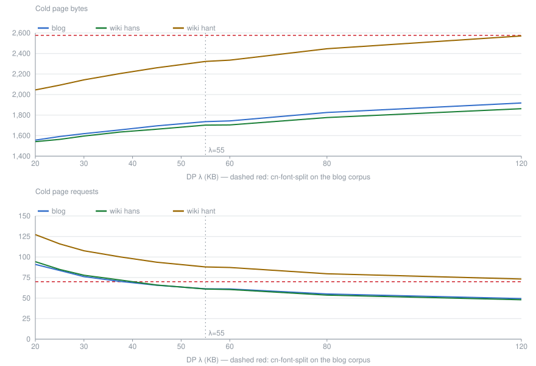
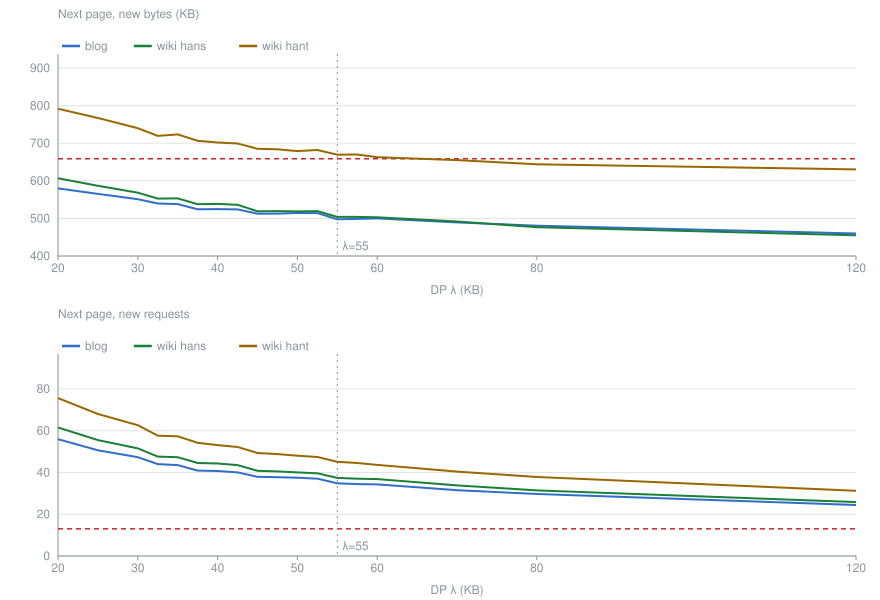
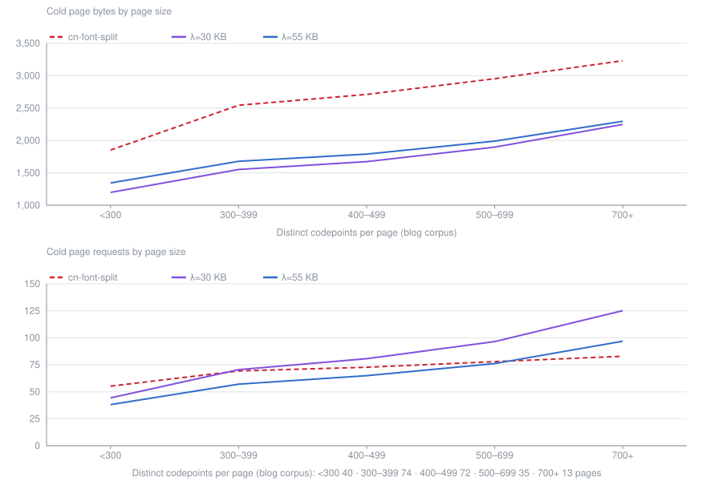

# Font-split benchmark

Page cost and loading time of the font-slicing algorithm on production content, and the measurements behind the
decisions of [ADR-0010](../../docs/adr/0010-frequency-ordered-byte-aware-font-slicing.md). Snapshot 2026-11-25; every
number below is produced by `tests/page_cost.rs`, by the throttled-browser run, or by the build experiment of the last
section, as described in [Method](#method).

## Method

- **Font**: `data/fonts/calendar.ttf` — the deployed post font OPPOSerif, 38.3 MiB, 29,251 codepoints, variable. It is
  never committed; the harness reads it locally.
- **Pages**: `tests/fixtures/pages/blog-zh-hans-234.txt` (all 234 published posts and pages of the production blog, as
  codepoint sets; median 404 distinct codepoints per page) and the 64 held-out zhwiki pages per script dimension.
- **Page cost**: a page downloads every chunk whose `unicode-range` intersects its codepoints. _Cold page_ is the first
  page a visitor opens; _next page_ is the mean over all ordered page pairs of what a second page adds to the cache;
  _session_ is the union of 5 consecutive pages in publish order.
- **cn-font-split package**: the wasm slicer the server used before the napi port (git `120cbd7cd`), re-run on the same
  font with the same options: 655 chunks, 30,567,221 B — byte-exact with the `font` row of the production database.
- **Loading time**: headless Chromium, 4 page pairs per point on 1.6 Mbps / 150 ms and 10 on 20 Mbps / 40 ms, over
  HTTP/1.1 and HTTP/2; the median paired time until every font of a page is loaded, relative to λ=30 KB.

Reproduce with the scripts of `package.json`: `pagecost:report` (the shipped algorithm), `pagecost:sweep` (the λ
frontier), and `FONT_SPLIT_BENCH_PACKAGE=<dir> pnpm run pagecost:report` for a package already on disk.

## cn-font-split package against the retune

| Blog corpus, mean per page      | cn-font-split (wasm, 655 chunks) | λ=30 KB (812 chunks) | **λ=55 KB (731 chunks)** | λ=55 vs cn-font-split |
| ------------------------------- | -------------------------------- | -------------------- | ------------------------ | --------------------- |
| Cold page                       | 2,576 KB                         | 1,467 KB             | 1,586 KB                 | -38%                  |
| Cold page p90                   | 3,285 KB                         | 1,994 KB             | 2,096 KB                 | -36%                  |
| Cold requests                   | 70.0                             | 90.5                 | 70.5                     | +1%                   |
| Cold requests p90 / max         | 84 / 103                         | 125 / 233            | 98 / 182                 | p90 +17%              |
| Session of 5 pages              | 4,033 KB                         | 2,978 KB             | 2,976 KB                 | -26%                  |
| Next page, new bytes            | 659 KB                           | 551 KB               | 498 KB                   | -24%                  |
| Next page, new requests         | 13.0                             | 47.3                 | 34.8                     | +168%                 |
| Package (chunks + CSS)          | 30.57 MB                         | 25.83 MB             | 25.72 MB                 | -16%                  |
| result.css with the family name | 238 KB                           | 293 KB               | 278 KB                   |                       |

## The λ frontier

The DP’s λ is the price of one request in bytes. The frontier is a staircase: the chunk boundaries jump at discrete
values, so neighbouring λ often produce the same package.

| λ KB | chunks | blog: cold KB / req | blog: req p90 / max | blog: next page KB / req | wiki hans: cold KB / req | wiki hant: cold KB / req |
| ---: | -----: | ------------------: | ------------------: | -----------------------: | -----------------------: | -----------------------: |
|   20 |    869 |       1,408 / 104.4 |           147 / 267 |               580 / 55.9 |            1,422 / 111.1 |            1,933 / 135.4 |
|   25 |    835 |        1,442 / 96.6 |           134 / 244 |               565 / 50.6 |            1,448 / 101.7 |            1,982 / 124.9 |
|   30 |    812 |        1,467 / 90.5 |           125 / 233 |               551 / 47.3 |             1,466 / 94.2 |            2,025 / 116.6 |
| 37.5 |    774 |        1,513 / 78.9 |           111 / 207 |               524 / 40.9 |             1,512 / 82.1 |            2,104 / 104.5 |
|   45 |    751 |        1,554 / 74.9 |           106 / 191 |               513 / 37.9 |             1,546 / 77.2 |             2,157 / 98.8 |
|   55 |    731 |        1,586 / 70.5 |            98 / 182 |               498 / 34.8 |             1,577 / 72.1 |             2,212 / 93.4 |
|   60 |    724 |        1,594 / 70.2 |            99 / 183 |               500 / 34.3 |             1,578 / 71.2 |             2,228 / 91.5 |
|   80 |    693 |        1,669 / 64.6 |            92 / 157 |               481 / 29.7 |             1,646 / 64.4 |             2,323 / 85.1 |
|  120 |    657 |        1,762 / 58.9 |            81 / 138 |               460 / 24.4 |             1,730 / 58.0 |             2,447 / 78.7 |

## By page size

Short pages need fewer requests than cn-font-split, long pages more: a long page touches more of the small mid-frequency
chunks. Every size band saves bytes (−34% to −40%).

| Distinct codepoints | pages |       cn-font-split |              λ=30 KB |              λ=55 KB |            λ=120 KB |
| ------------------- | ----: | ------------------: | -------------------: | -------------------: | ------------------: |
| &lt; 300            |    40 | 1,852 KB / 55.2 req |  1,045 KB / 52.5 req |  1,204 KB / 43.6 req | 1,378 KB / 39.6 req |
| 300–399             |    74 | 2,543 KB / 69.3 req |  1,394 KB / 83.2 req |  1,528 KB / 65.6 req | 1,725 KB / 56.4 req |
| 400–499             |    72 | 2,710 KB / 72.7 req |  1,514 KB / 95.4 req |  1,633 KB / 74.4 req | 1,813 KB / 61.6 req |
| 500–699             |    35 | 2,953 KB / 77.9 req | 1,766 KB / 116.8 req |  1,841 KB / 87.9 req | 1,998 KB / 70.9 req |
| 700+                |    13 | 3,231 KB / 82.8 req | 2,119 KB / 151.1 req | 2,145 KB / 112.6 req | 2,245 KB / 86.1 req |

## Loading time

A request costs 6–10 ms on HTTP/1.1 (six connections) and 1–8 ms on HTTP/2, so bytes dominate slow links and requests
dominate fast HTTP/1.1 links.

|           | Protocol | Link | pairs |  λ 30 |  37.5 |    45 |    55 |    80 |   120 |
| --------- | -------- | ---- | ----: | ----: | ----: | ----: | ----: | ----: | ----: |
| Cold page | H1       | slow |     4 | 1.000 | 1.061 | 1.089 | 1.090 | 1.140 | 1.153 |
| Next page | H1       | slow |     4 | 1.000 | 0.966 | 0.933 | 0.904 | 0.876 | 0.894 |
| Cold page | H1       | fast |    10 | 1.000 | 0.976 | 0.955 | 0.925 | 0.927 | 0.980 |
| Next page | H1       | fast |    10 | 1.000 | 0.942 | 0.861 | 0.840 | 0.736 | 0.681 |
| Cold page | H2       | slow |     4 | 1.000 | 1.056 | 1.083 | 1.085 | 1.140 | 1.150 |
| Next page | H2       | slow |     4 | 1.000 | 0.974 | 0.932 | 0.920 | 0.901 | 0.929 |
| Cold page | H2       | fast |    10 | 1.000 | 1.005 | 1.024 | 1.045 | 1.080 | 1.107 |
| Next page | H2       | fast |    10 | 1.000 | 0.954 | 0.916 | 0.915 | 0.866 | 0.868 |

## Decision

λ=55 KB, μ=0.5 KB. The flat optimum of measured loading time is the 45–55 KB band; 55 was taken for the request side
(4.4 fewer requests per cold page than 45, a better tail, a strictly better next page) for 32 KB per cold page. The
rationale and the rejected alternatives are recorded in ADR-0010.

## Fixture-font baseline

The pinned gate of `page_cost_baseline_is_pinned` runs on the committed OFL fixture font (≈0.3 KB per glyph), where the
retune trades bytes for requests.

| Corpus    | λ=30 KB: chunks, cold mean / p90, requests, session(5), incremental | λ=55 KB                                                         |
| --------- | ------------------------------------------------------------------- | --------------------------------------------------------------- |
| wiki hans | 100 · 871,719 B / 1,125,584 B · 42.8 · 1,307,477 B · 184,704 B      | 77 · 926,149 B / 1,144,896 B · 34.9 · 1,298,882 B · 158,931 B   |
| wiki hant | 100 · 799,602 B / 1,012,504 B · 35.8 · 1,204,333 B · 160,284 B      | 77 · 863,018 B / 1,044,896 B · 30.2 · 1,216,947 B · 140,673 B   |
| blog      | 100 · 964,672 B / 1,186,740 B · 48.6 · 1,435,255 B · 214,985 B      | 77 · 1,024,863 B / 1,220,148 B · 40.7 · 1,425,980 B · 187,167 B |

## Slicing time and build profile

| Variant                                     | Slicing time (8 threads) | Output              | Verdict                                                        |
| ------------------------------------------- | -----------------------: | ------------------- | -------------------------------------------------------------- |
| WOFF2 quality 8 / 9                         |          0.50 s / 0.60 s | 27.40 MB / 27.32 MB | about +7.5% bytes for a 20–24× faster upload; quality stays 11 |
| WOFF2 quality 10                            |                   6.24 s | 25.46 MB            | not worth another 6 s for 0.1%                                 |
| WOFF2 quality 11, previous profile          |                  12.66 s | 25.44 MB            |                                                                |
| WOFF2 quality 11, codegen-units = 1 + strip |                  11.87 s | 25.44 MB            | **shipped**: −4% time, addon 4.68 MB → 3.70 MB                 |
| + profile-guided optimization               |                  11.81 s | 25.44 MB            | rejected: no measurable gain                                   |
| Native woff2 + Google Brotli                |                  12.12 s | 25.44 MB            | rejected: same time, same size                                 |

Subsetting itself is 1% of the slicing time (0.12 s for all 731 chunks); compression at quality 11 is the rest.
