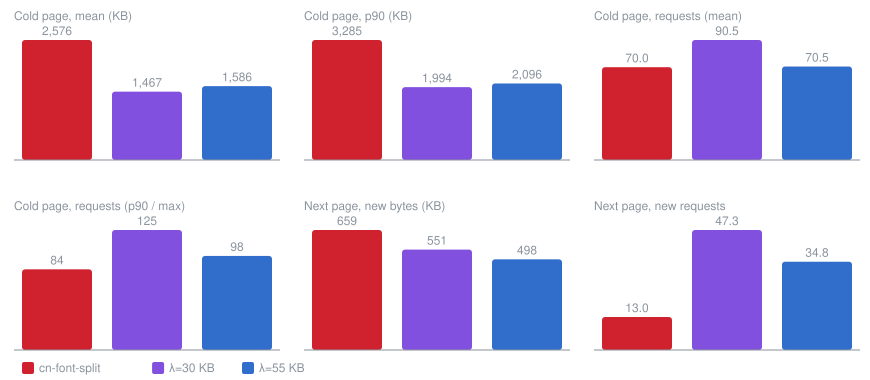
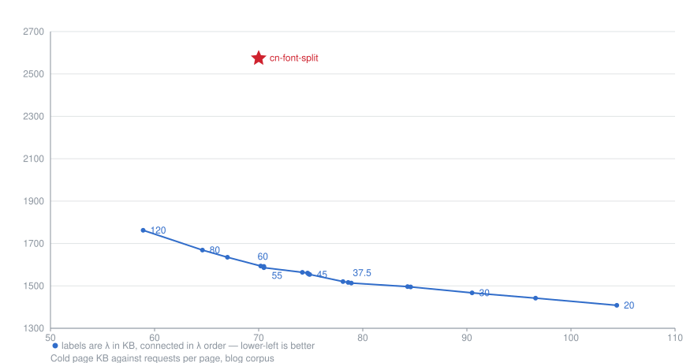
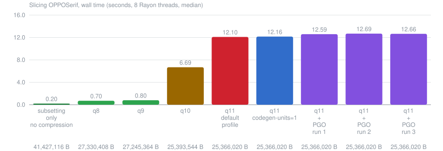

# Font-split benchmark

Page cost and loading time of the font-slicing algorithm on production content, and the measurements behind the
decisions of [ADR-0010](../../docs/adr/0010-frequency-ordered-byte-aware-font-slicing.md). Two snapshots: 2026-11-25
(frequency-ordered tables + byte-aware DP) and 2026-11-26 (complete shaping closure + per-pack byte model — the shipped
algorithm). Every number is produced by `tests/page_cost.rs`, by the throttled-browser run, or by the build experiment
of the last section, as described in [Method](#method).

The charts belong to the 2026-11-25 snapshot and were not redrawn; the tables in
[the 2026-11-26 section](#snapshot-2026-11-26-shaping-closure-and-per-pack-byte-model) supersede them.

## Method

- **Font**: `data/fonts/calendar.ttf` — the deployed post font OPPOSerif, 38.3 MiB, 29,251 codepoints, variable. It is
  never committed; the harness reads it locally.
- **Pages**: `tests/fixtures/pages/blog-zh-hans-234.txt` (all 234 published posts and pages of the production blog, as
  codepoint sets; median 404 distinct codepoints per page) and the 64 held-out zhwiki pages per script dimension.
- **Page cost**: a page downloads every chunk whose `unicode-range` intersects its codepoints. _Cold page_ is the first
  page a visitor opens; _next page_ is the mean over all ordered page pairs of what a second page adds to the cache;
  _session_ is the union of 5 consecutive pages in publish order.
- **cn-font-split package**: the wasm slicer the server used before the napi port (git `120cbd7cd`), re-run on the same
  font with the same options: 655 chunks, 30,567,221 B — byte-exact with the `font` row of the production database.
- **Loading time**: headless Chromium, 4 page pairs per point on 1.6 Mbps / 150 ms and 10 on 20 Mbps / 40 ms, over
  HTTP/1.1 and HTTP/2; the median paired time until every font of a page is loaded, relative to λ=30 KB.

Reproduce with the scripts of `package.json`: `pagecost:report` (the shipped algorithm), `pagecost:sweep` (the λ
frontier), and `FONT_SPLIT_BENCH_PACKAGE=<dir> pnpm run pagecost:report` for a package already on disk.

## Snapshot 2026-11-26: shaping closure and per-pack byte model

The shipped algorithm: complete GSUB/GPOS relation collection, a per-pack byte probe and an order-stable cmap lookup
([ADR-0010](../../docs/adr/0010-frequency-ordered-byte-aware-font-slicing.md), 2026-11-26 revision). Same font, corpora,
λ and harness as the 2026-11-25 snapshot; "before" is that snapshot's λ=55 column.

### Shipped algorithm against the 2026-11-25 retune

| Blog corpus, mean per page | 2026-11-25 (731 chunks) | **2026-11-26 (707 chunks)** |     Δ |
| -------------------------- | ----------------------: | --------------------------: | ----: |
| Cold page                  |                1,586 KB |                    1,736 KB | +9.5% |
| Cold page p90              |                2,096 KB |                    2,266 KB | +8.1% |
| Cold requests              |                    70.5 |                        61.3 |  -13% |
| Cold requests p90 / max    |                98 / 182 |                    88 / 154 |       |
| Session of 5 pages         |                2,976 KB |                    3,088 KB | +3.8% |
| Next page, new bytes       |                  498 KB |                      492 KB | -1.2% |
| Next page, new requests    |                    34.8 |                        29.5 |  -15% |
| Package (chunks + CSS)     |                25.72 MB |                    25.64 MB | -0.3% |

Against the deployed cn-font-split package (2,576 KB / 70.0 requests per cold page): -33% bytes for -12% requests.

| Corpus    | 2026-11-25 cold KB / req | 2026-11-26 cold KB / req | Next page 2026-11-25 | Next page 2026-11-26 |
| --------- | -----------------------: | -----------------------: | -------------------: | -------------------: |
| wiki hans |             1,577 / 72.1 |             1,702 / 61.0 |    504 KB / 37.4 req |    497 KB / 31.7 req |
| wiki hant |             2,212 / 93.4 |             2,323 / 87.9 |    670 KB / 45.1 req |    661 KB / 42.2 req |
| blog      |             1,586 / 70.5 |             1,736 / 61.3 |    498 KB / 34.8 req |    492 KB / 29.5 req |

The bytes have one cause: the Latin closure (856 characters) is a single 115.9 KB face instead of two ≈25 KB ASCII
faces, and every page with Latin text or digits downloads it. The requests have another: non-Han packs are priced by
their real bytes and shrink from 28 to 17 faces.

`og.ttf` (22 MB; its GPOS is not Extension-wrapped): blog cold page 1,154 KB / 50.9 requests (p90 74 / max 122) → 1,215
KB / 41.5 (p90 61 / max 98), next page +321 KB / +23.4 requests → +304 KB / +18.4; 449 → 439 faces; largest face 77.7 →
80.4 KB.

### Shaping co-location

Relations whose glyphs ship in the same `@font-face`, old and new packages measured with one script. A browser cannot
kern, attach a mark to, or ligate across two faces of one family.

| Relations                                 | OPPOSerif 2026-11-25 | OPPOSerif 2026-11-26 | og 2026-11-25 | og 2026-11-26 |
| ----------------------------------------- | -------------------: | -------------------: | ------------: | ------------: |
| Kern pairs, ASCII–ASCII (1,397 / 770)     |                54.4% |                 100% |          100% |          100% |
| Kern pairs, all mapped (123,791 / 53,008) |                 6.8% |                 100% |         94.6% |          100% |
| Mark-to-base pairs (14,328 / 14,590)      |                 4.6% |                 100% |          100% |          100% |
| Ligature component sets (36 / 33)         |                91.7% |                 100% |         93.9% |          100% |

OPPOSerif keeps all of its pair-positioning and mark-to-base subtables inside Extension lookups, which the 2026-11-25
relation collector skipped.

Rendered in Chrome (Playwright; element screenshots at 48 px with kerning and common ligatures on; each package served
from a local static server next to the original TTF):

| String (48 px)                  | Original width | 2026-11-26 vs original | 2026-11-25 vs original |
| ------------------------------- | -------------: | ---------------------- | ---------------------: |
| `To Tale Av Way WA LT P. T, V`  |       614.1 px | pixel-identical        |      651.2 px, differs |
| `AVAWA Ta Vo We Yo PA We`       |       580.4 px | pixel-identical        |      631.5 px, differs |
| `Office flow waffle fish fi fl` |       512.8 px | pixel-identical        |      516.0 px, differs |
| `é á ñ ö À` (combining)         |       187.0 px | pixel-identical        |                differs |
| `Ångström naïve café`           |       420.1 px | pixel-identical        |      421.5 px, differs |
| `中文测试，标点。「引用」`      |       584.5 px | pixel-identical        |        pixel-identical |
| `2026-11-26 Kobato`             |       391.5 px | pixel-identical        |      391.9 px, differs |

On `og.ttf`, both packages are pixel-identical to the original on all seven strings. A one-off check, not a committed
gate.

### λ frontier, re-swept

`pagecost:sweep`, μ=0.5 KB:

| λ KB   | Chunks | Blog: cold KB / req | Blog req p90 / max | Blog next KB / req | Wiki hans: cold KB / req | Wiki hant: cold KB / req |
| ------ | -----: | ------------------: | -----------------: | -----------------: | -----------------------: | -----------------------: |
| 20     |    832 |        1,556 / 91.0 |          126 / 225 |         571 / 47.2 |             1,542 / 94.3 |            2,045 / 127.3 |
| 25     |    802 |        1,592 / 83.6 |          119 / 210 |         555 / 43.0 |             1,563 / 84.9 |            2,091 / 116.0 |
| 30     |    776 |        1,619 / 76.1 |          106 / 192 |         539 / 39.2 |             1,596 / 77.8 |            2,143 / 107.6 |
| 37.5   |    750 |        1,656 / 70.2 |          101 / 181 |         522 / 35.6 |             1,635 / 71.9 |            2,205 / 100.1 |
| 45     |    729 |        1,696 / 65.6 |           94 / 163 |         506 / 32.5 |             1,662 / 65.9 |             2,261 / 93.7 |
| **55** |    707 |        1,736 / 61.3 |           88 / 154 |         492 / 29.5 |             1,702 / 61.0 |             2,323 / 87.9 |
| 60     |    702 |        1,743 / 61.1 |           88 / 150 |         492 / 29.0 |             1,704 / 60.5 |             2,335 / 87.2 |
| 80     |    671 |        1,825 / 55.0 |           77 / 131 |         463 / 24.5 |             1,776 / 53.6 |             2,446 / 79.6 |
| 120    |    636 |        1,918 / 49.4 |           70 / 112 |         445 / 20.1 |             1,862 / 47.9 |             2,571 / 73.2 |

The staircase keeps its shape: up to λ=55 a request saved costs 6–9 KB, 55 → 60 changes nothing, beyond 60 it costs
13–17 KB. **λ=55 KB stands.**

### By page size (blog corpus, 2026-11-26)

Short pages need fewer requests than on 2026-11-25, long pages more; every size band saves requests.

| Distinct codepoints | Pages |  2026-11-25, λ=55 KB | **2026-11-26, λ=55 KB** |  2026-11-26, λ=30 KB | 2026-11-26, λ=120 KB |
| ------------------- | ----: | -------------------: | ----------------------: | -------------------: | -------------------: |
| < 300               |    40 |  1,204 KB / 43.6 req |     1,344 KB / 38.1 req |  1,198 KB / 44.3 req |  1,533 KB / 33.8 req |
| 300–399             |    74 |  1,528 KB / 65.6 req |     1,678 KB / 57.0 req |  1,553 KB / 70.5 req |  1,882 KB / 47.0 req |
| 400–499             |    72 |  1,633 KB / 74.4 req |     1,790 KB / 64.9 req |  1,674 KB / 80.7 req |  1,973 KB / 51.8 req |
| 500–699             |    35 |  1,841 KB / 87.9 req |     1,991 KB / 76.1 req |  1,897 KB / 96.5 req |  2,151 KB / 59.3 req |
| 700+                |    13 | 2,145 KB / 112.6 req |     2,296 KB / 96.8 req | 2,247 KB / 125.2 req |  2,378 KB / 71.0 req |

### Fixture-font baseline (pinned)

The gate `page_cost_baseline_is_pinned` runs on the committed OFL fixture font (≈0.3 KB per glyph). 2026-11-25 values
were 77 chunks / 1,515,080 B and 34.9 / 30.2 / 40.7 chunks per page.

| Corpus    | Chunks, cold mean / p90, requests, session(5), incremental      |
| --------- | --------------------------------------------------------------- |
| wiki hans | 69 · 935,266 B / 1,147,088 B · 29.1 · 1,278,362 B · 145,219 B   |
| wiki hant | 69 · 875,031 B / 1,053,664 B · 24.7 · 1,198,706 B · 127,330 B   |
| blog      | 69 · 1,030,865 B / 1,212,728 B · 34.6 · 1,418,430 B · 179,328 B |

### Costs

- **Slicing time +13%**: 13.8 s → 15.5 s for the 38 MiB font, 6.8 s → 7.7 s for og (8 threads, interleaved runs). The
  probes cost 0.15 s more than the old global sample — 136 ms for 17 quality-9 probes, 13 ms + 323 ms for the pooled
  quality-9/quality-11 pair, against 324 ms for the old global quality-11 sample. The rest is the compression phase:
  fewer but larger faces, and q11 is superlinear in face size (0.31 s per 73 KB face, 1.08 s per 118 KB).
- **Fingerprint** `99475c9dd394` → `1dca6e172640`: every already-uploaded font is re-sliced on its next upload.
- **Not re-run**: the throttled-browser loading-time measurement below; it models the byte/request exchange, which the
  re-swept frontier shows unchanged.

## 2026-11-25 snapshot

The sections from here on are the 2026-11-25 snapshot: the frequency-ordered tables and the byte-aware DP before the
2026-11-26 revision.

### cn-font-split package against the retune

| Blog corpus, mean per page      | cn-font-split (wasm, 655 chunks) | λ=30 KB (812 chunks) | **λ=55 KB (731 chunks)** | λ=55 vs cn-font-split |
| ------------------------------- | -------------------------------- | -------------------- | ------------------------ | --------------------- |
| Cold page                       | 2,576 KB                         | 1,467 KB             | 1,586 KB                 | -38%                  |
| Cold page p90                   | 3,285 KB                         | 1,994 KB             | 2,096 KB                 | -36%                  |
| Cold requests                   | 70.0                             | 90.5                 | 70.5                     | +1%                   |
| Cold requests p90 / max         | 84 / 103                         | 125 / 233            | 98 / 182                 | p90 +17%              |
| Session of 5 pages              | 4,033 KB                         | 2,978 KB             | 2,976 KB                 | -26%                  |
| Next page, new bytes            | 659 KB                           | 551 KB               | 498 KB                   | -24%                  |
| Next page, new requests         | 13.0                             | 47.3                 | 34.8                     | +168%                 |
| Package (chunks + CSS)          | 30.57 MB                         | 25.83 MB             | 25.72 MB                 | -16%                  |
| result.css with the family name | 238 KB                           | 293 KB               | 278 KB                   |                       |

### The λ frontier

The DP’s λ is the price of one request in bytes. The frontier is a staircase: the chunk boundaries jump at discrete
values, so neighbouring λ often produce the same package.

| λ KB | chunks | blog: cold KB / req | blog: req p90 / max | blog: next page KB / req | wiki hans: cold KB / req | wiki hant: cold KB / req |
| ---: | -----: | ------------------: | ------------------: | -----------------------: | -----------------------: | -----------------------: |
|   20 |    869 |       1,408 / 104.4 |           147 / 267 |               580 / 55.9 |            1,422 / 111.1 |            1,933 / 135.4 |
|   25 |    835 |        1,442 / 96.6 |           134 / 244 |               565 / 50.6 |            1,448 / 101.7 |            1,982 / 124.9 |
|   30 |    812 |        1,467 / 90.5 |           125 / 233 |               551 / 47.3 |             1,466 / 94.2 |            2,025 / 116.6 |
| 37.5 |    774 |        1,513 / 78.9 |           111 / 207 |               524 / 40.9 |             1,512 / 82.1 |            2,104 / 104.5 |
|   45 |    751 |        1,554 / 74.9 |           106 / 191 |               513 / 37.9 |             1,546 / 77.2 |             2,157 / 98.8 |
|   55 |    731 |        1,586 / 70.5 |            98 / 182 |               498 / 34.8 |             1,577 / 72.1 |             2,212 / 93.4 |
|   60 |    724 |        1,594 / 70.2 |            99 / 183 |               500 / 34.3 |             1,578 / 71.2 |             2,228 / 91.5 |
|   80 |    693 |        1,669 / 64.6 |            92 / 157 |               481 / 29.7 |             1,646 / 64.4 |             2,323 / 85.1 |
|  120 |    657 |        1,762 / 58.9 |            81 / 138 |               460 / 24.4 |             1,730 / 58.0 |             2,447 / 78.7 |

### By page size

Short pages need fewer requests than cn-font-split, long pages more: a long page touches more of the small mid-frequency
chunks. Every size band saves bytes (−34% to −40%).

| Distinct codepoints | pages |       cn-font-split |              λ=30 KB |              λ=55 KB |            λ=120 KB |
| ------------------- | ----: | ------------------: | -------------------: | -------------------: | ------------------: |
| &lt; 300            |    40 | 1,852 KB / 55.2 req |  1,045 KB / 52.5 req |  1,204 KB / 43.6 req | 1,378 KB / 39.6 req |
| 300–399             |    74 | 2,543 KB / 69.3 req |  1,394 KB / 83.2 req |  1,528 KB / 65.6 req | 1,725 KB / 56.4 req |
| 400–499             |    72 | 2,710 KB / 72.7 req |  1,514 KB / 95.4 req |  1,633 KB / 74.4 req | 1,813 KB / 61.6 req |
| 500–699             |    35 | 2,953 KB / 77.9 req | 1,766 KB / 116.8 req |  1,841 KB / 87.9 req | 1,998 KB / 70.9 req |
| 700+                |    13 | 3,231 KB / 82.8 req | 2,119 KB / 151.1 req | 2,145 KB / 112.6 req | 2,245 KB / 86.1 req |

### Loading time

A request costs 6–10 ms on HTTP/1.1 (six connections) and 1–8 ms on HTTP/2, so bytes dominate slow links and requests
dominate fast HTTP/1.1 links.

|           | Protocol | Link | pairs |  λ 30 |  37.5 |    45 |    55 |    80 |   120 |
| --------- | -------- | ---- | ----: | ----: | ----: | ----: | ----: | ----: | ----: |
| Cold page | H1       | slow |     4 | 1.000 | 1.061 | 1.089 | 1.090 | 1.140 | 1.153 |
| Next page | H1       | slow |     4 | 1.000 | 0.966 | 0.933 | 0.904 | 0.876 | 0.894 |
| Cold page | H1       | fast |    10 | 1.000 | 0.976 | 0.955 | 0.925 | 0.927 | 0.980 |
| Next page | H1       | fast |    10 | 1.000 | 0.942 | 0.861 | 0.840 | 0.736 | 0.681 |
| Cold page | H2       | slow |     4 | 1.000 | 1.056 | 1.083 | 1.085 | 1.140 | 1.150 |
| Next page | H2       | slow |     4 | 1.000 | 0.974 | 0.932 | 0.920 | 0.901 | 0.929 |
| Cold page | H2       | fast |    10 | 1.000 | 1.005 | 1.024 | 1.045 | 1.080 | 1.107 |
| Next page | H2       | fast |    10 | 1.000 | 0.954 | 0.916 | 0.915 | 0.866 | 0.868 |

### Decision

λ=55 KB, μ=0.5 KB. The flat optimum of measured loading time is the 45–55 KB band; 55 was taken for the request side
(4.4 fewer requests per cold page than 45, a better tail, a strictly better next page) for 32 KB per cold page. The
rationale and the rejected alternatives are recorded in ADR-0010. Re-swept on the 2026-11-26 algorithm: the knee is
unchanged and λ=55 stands.

### Fixture-font baseline

Values of the 2026-11-25 snapshot on the committed OFL fixture font (≈0.3 KB per glyph), where the retune trades bytes
for requests; the gate now pins the 2026-11-26 numbers above.

| Corpus    | λ=30 KB: chunks, cold mean / p90, requests, session(5), incremental | λ=55 KB                                                         |
| --------- | ------------------------------------------------------------------- | --------------------------------------------------------------- |
| wiki hans | 100 · 871,719 B / 1,125,584 B · 42.8 · 1,307,477 B · 184,704 B      | 77 · 926,149 B / 1,144,896 B · 34.9 · 1,298,882 B · 158,931 B   |
| wiki hant | 100 · 799,602 B / 1,012,504 B · 35.8 · 1,204,333 B · 160,284 B      | 77 · 863,018 B / 1,044,896 B · 30.2 · 1,216,947 B · 140,673 B   |
| blog      | 100 · 964,672 B / 1,186,740 B · 48.6 · 1,435,255 B · 214,985 B      | 77 · 1,024,863 B / 1,220,148 B · 40.7 · 1,425,980 B · 187,167 B |

### Slicing time and build profile

Times are those of the 2026-11-25 algorithm at 8 threads; the 2026-11-26 revision adds +13% (see [Costs](#costs)).

| Variant                                     | Slicing time (8 threads) | Output              | Verdict                                                        |
| ------------------------------------------- | -----------------------: | ------------------- | -------------------------------------------------------------- |
| WOFF2 quality 8 / 9                         |          0.50 s / 0.60 s | 27.40 MB / 27.32 MB | about +7.5% bytes for a 20–24× faster upload; quality stays 11 |
| WOFF2 quality 10                            |                   6.24 s | 25.46 MB            | not worth another 6 s for 0.1%                                 |
| WOFF2 quality 11, previous profile          |                  12.66 s | 25.44 MB            |                                                                |
| WOFF2 quality 11, codegen-units = 1 + strip |                  11.87 s | 25.44 MB            | **shipped**: −4% time, addon 4.68 MB → 3.70 MB                 |
| + profile-guided optimization               |                  11.81 s | 25.44 MB            | rejected: no measurable gain                                   |
| Native woff2 + Google Brotli                |                  12.12 s | 25.44 MB            | rejected: same time, same size                                 |

Subsetting itself is 1% of the slicing time (0.12 s for all 731 chunks); compression at quality 11 is the rest.
