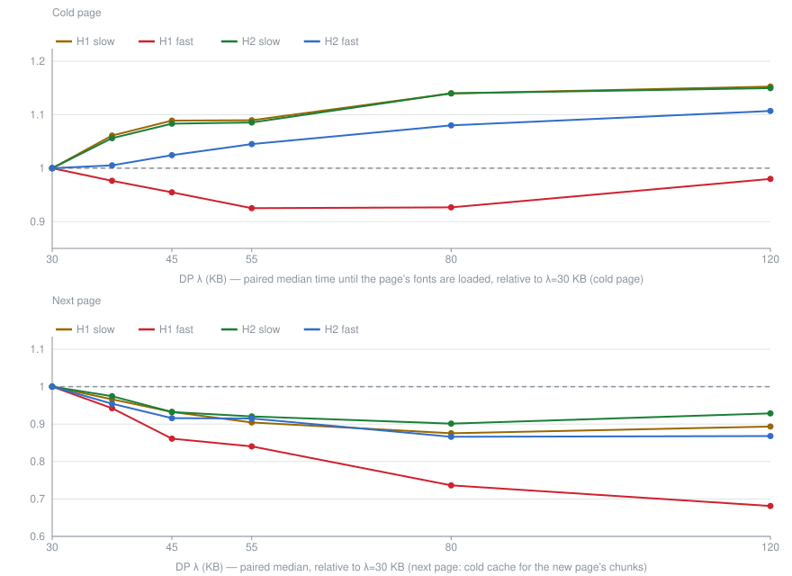

# Font-split benchmark

Page cost and loading time of the font-slicing algorithm on production content, and the measurements behind the
decisions of [ADR-0010](../../docs/adr/0010-frequency-ordered-byte-aware-font-slicing.md). Everything between the
`bench` markers is generated by `pnpm run bench:font-split` (`tools/font-split/scripts/bench/`) from
`benchmark/results.json`; the prose around the blocks is hand-written.

<!-- bench:start header -->

Measured **2026-11-27** on commit `4dc336e8b` (Intel(R) Xeon(R) W-2191B CPU @ 2.30GHz, 36 logical CPUs; rustc 1.100.0
(0ef1bc386 2026-11-09) (Homebrew); Node v26.13.1, Chrome 158.0.8127.89) with `pnpm run bench:font-split`. Algorithm
fingerprint `1dca6e172640`. The deployed package was measured on 2026-11-27.

<!-- bench:end header -->

## Method

- **Fonts**: the two production fonts under `data/fonts/` (never committed) — the deployed post font OPPOSerif is the
  primary one, `og.ttf` the second.
- **Pages**: `tests/fixtures/pages/blog-zh-hans-234.txt` (all published posts and pages of the production blog, as
  codepoint sets) and the 64 held-out zhwiki pages per script dimension.
- **Page cost**: a page downloads every chunk whose `unicode-range` intersects its codepoints. _Cold page_ is the first
  page a visitor opens; _next page_ is the mean over all ordered page pairs of what a second page adds to the cache;
  _session_ is the union of 5 consecutive pages in publish order. `tests/page_cost.rs` measures it.
- **cn-font-split package**: the wasm slicer the server used before the napi port, re-run on the same font with the same
  options. Its page cost lives in `benchmark/deployed-package.json`; `--deployed-package <dir>` re-measures it.
- **Loading time**: headless Chrome loads each blog page — its full codepoint set as text — from a local static server
  over HTTP/1.1 and HTTP/2 under network throttling; the time runs from navigation start to the end of the last font
  response. The run fails when the browser does not fetch exactly the chunks the offline rule predicts.
- **Shaping co-location**: a harness in the crate (`tests/shaping_colocation.rs`) reads the font's GSUB/GPOS tables and
  the package's `result.css` and counts the relations whose glyphs ship in the same `@font-face`.
- **Rendering**: element screenshots at 48 px with kerning and common ligatures on, the original TTF against the
  package, compared pixel by pixel.
- **Slicing time**: wall time of `fontSplit` through the Node addon, one fresh process per run, the variants
  interleaved.
- **Profile-guided optimization**: trained on the benchmark fonts and rebuilt independently for each of its rows — its
  effect depends on the training run, so every build is timed on its own.

<!-- bench:start parameters -->

- **Sweep**: λ = 20, 25, 30, 37.5, 45, 55, 60, 80, 120 KB at μ = 0.5 KB; the loading-time stage compares λ = 30, 37.5,
  45, 55, 80, 120 KB.
- **Links**: slow link 1.6 Mbps down, 0.75 up, 150 ms latency; fast link 20 Mbps down, 10 up, 40 ms latency.
- **Samples**: 4 page pairs per point on the slow link and 10 page pairs on the fast link; 5 interleaved slicing runs
  per variant (3 for the second font) at 8 Rayon threads.
- **Corpora**: 234 blog pages, 64 held-out wiki pages per script dimension.

<!-- bench:end parameters -->

Reproduce with `pnpm run bench:font-split` (about half an hour; `--quick` is a smoke run, `--skip <stage>` carries a
stage over from the previous `results.json`, `--report-only` redraws the charts and this document).

## The shipped algorithm against the deployed package

<!-- bench:start shipped-vs-deployed -->

| Blog corpus, mean per page      | cn-font-split (wasm, 655 chunks) | **Shipped (λ=55 KB, 707 chunks)** |       Δ |
| ------------------------------- | -------------------------------: | --------------------------------: | ------: |
| Cold page                       |                         2,576 KB |                          1,736 KB |    −33% |
| Cold page p90                   |                         3,285 KB |                          2,266 KB |    −31% |
| Cold requests                   |                             70.0 |                              61.3 |    −12% |
| Cold requests p90 / max         |                         84 / 103 |                          88 / 154 | p90 +5% |
| Session of 5 pages              |                         4,033 KB |                          3,088 KB |    −23% |
| Next page, new bytes            |                           659 KB |                            492 KB |    −25% |
| Next page, new requests         |                             13.0 |                              29.5 |   +126% |
| Package (chunks + CSS)          |                         30.57 MB |                          25.65 MB |    −16% |
| result.css with the family name |                           238 KB |                            274 KB |    +15% |

<!-- bench:end shipped-vs-deployed -->

<!-- bench:start corpora -->

| Corpus    | cn-font-split cold KB / req | Shipped cold KB / req | cn-font-split next page | Shipped next page |
| --------- | --------------------------: | --------------------: | ----------------------: | ----------------: |
| wiki hans |                2,815 / 75.6 |          1,702 / 61.0 |       803 KB / 15.6 req | 497 KB / 31.7 req |
| wiki hant |               4,061 / 123.0 |          2,323 / 87.9 |     1,340 KB / 29.7 req | 661 KB / 42.2 req |
| blog      |                2,576 / 70.0 |          1,736 / 61.3 |       659 KB / 13.0 req | 492 KB / 29.5 req |

<!-- bench:end corpora -->

<!-- bench:start package-facts -->

The primary font `calendar.ttf` (38.3 MiB): 707 faces; blog cold page 1,736 KB / 61.3 requests (p90 88 / max 154), next
page 492 KB / 29.5 requests; the largest face is 116 KB for 856 codepoints, 95 of them ASCII; 16 of the 707 faces
contain no ideograph.

The second font `og.ttf` (21.7 MiB): 439 faces; blog cold page 1,215 KB / 41.5 requests (p90 61 / max 98), next page 304
KB / 18.4 requests; the largest face is 80 KB for 99 codepoints; 15 of the 439 faces contain no ideograph.

<!-- bench:end package-facts -->

## Shaping co-location

Relations whose glyphs ship in the same `@font-face`. A browser cannot kern, attach a mark to, or ligate across two
faces of one family.

<!-- bench:start shaping-colocation -->

| Relations                                                                     | OPPOSerif |   og |
| ----------------------------------------------------------------------------- | --------: | ---: |
| Kern pairs with a non-zero adjustment, both glyphs ASCII (1,522 / 913)        |      100% | 100% |
| Kern pairs with a non-zero adjustment, both glyphs encoded (145,800 / 64,205) |      100% | 100% |
| Mark-to-base pairs of one subtable, both glyphs encoded (14,328 / 14,590)     |      100% | 100% |
| Ligatures whose components are all encoded (36 / 33)                          |      100% | 100% |

OPPOSerif carries 14 pair-positioning and 5 mark-to-base subtables, 19 Extension lookups among them; og carries 15
pair-positioning and 4 mark-to-base subtables, none inside Extension lookups.

<!-- bench:end shaping-colocation -->

## Rendering

Rendered in Chrome, each package served from a local static server next to the original TTF. A spot check, not a
committed gate.

<!-- bench:start rendering -->

| String (48 px)                  | Original width | OPPOSerif package vs original | og package vs original |
| ------------------------------- | -------------: | ----------------------------- | ---------------------- |
| `To Tale Av Way WA LT P. T, V`  |       614.1 px | pixel-identical               | pixel-identical        |
| `AVAWA Ta Vo We Yo PA We`       |       580.4 px | pixel-identical               | pixel-identical        |
| `Office flow waffle fish fi fl` |       512.8 px | pixel-identical               | pixel-identical        |
| `é á ñ ö À` (combining marks)   |       187.0 px | pixel-identical               | pixel-identical        |
| `Ångström naïve café`           |       420.1 px | pixel-identical               | pixel-identical        |
| `中文测试，标点。「引用」`      |       584.5 px | pixel-identical               | pixel-identical        |
| `2026-11-26 Kobato`             |       391.5 px | pixel-identical               | pixel-identical        |

<!-- bench:end rendering -->

## The λ frontier

The DP's λ is the price of one request in bytes. The frontier is a staircase: the chunk boundaries jump at discrete
values, so neighbouring λ often produce the same package.

<!-- bench:start frontier -->

|   λ KB | Chunks | Blog: cold KB / req | Blog req p90 / max | Blog next KB / req | Wiki hans: cold KB / req | Wiki hant: cold KB / req |
| -----: | -----: | ------------------: | -----------------: | -----------------: | -----------------------: | -----------------------: |
|     20 |    832 |        1,556 / 91.0 |          126 / 225 |         571 / 47.2 |             1,542 / 94.3 |            2,045 / 127.3 |
|     25 |    802 |        1,592 / 83.6 |          119 / 210 |         555 / 43.0 |             1,563 / 84.9 |            2,091 / 116.0 |
|     30 |    776 |        1,619 / 76.1 |          106 / 192 |         539 / 39.2 |             1,596 / 77.8 |            2,143 / 107.6 |
|   37.5 |    750 |        1,656 / 70.2 |          101 / 181 |         522 / 35.6 |             1,635 / 71.9 |            2,205 / 100.1 |
|     45 |    729 |        1,696 / 65.6 |           94 / 163 |         506 / 32.5 |             1,662 / 65.9 |             2,261 / 93.7 |
| **55** |    707 |        1,736 / 61.3 |           88 / 154 |         492 / 29.5 |             1,702 / 61.0 |             2,323 / 87.9 |
|     60 |    702 |        1,743 / 61.1 |           88 / 150 |         492 / 29.0 |             1,704 / 60.5 |             2,335 / 87.2 |
|     80 |    671 |        1,825 / 55.0 |           77 / 131 |         463 / 24.5 |             1,776 / 53.6 |             2,446 / 79.6 |
|    120 |    636 |        1,918 / 49.4 |           70 / 112 |         445 / 20.1 |             1,862 / 47.9 |             2,571 / 73.2 |

Between λ=30 KB and λ=55 KB every request saved costs 6.3–9.5 KB. λ=60 KB changes the package by 0.2 requests and 7 KB
per page. Beyond that a request saved costs 13.3–16.6 KB.

<!-- bench:end frontier -->

## By page size

<!-- bench:start by-page-size -->

Against the deployed package every size band changes its bytes by −34.0%–−27.4%; requests fall on 4 of 5 bands
(−31.0%–−2.2%) and rise on the rest (+16.9%). A long page touches more of the small mid-frequency chunks.

| Distinct codepoints | Pages |       cn-font-split |              λ=30 KB |         **λ=55 KB** |            λ=120 KB |
| ------------------: | ----: | ------------------: | -------------------: | ------------------: | ------------------: |
|                <300 |    40 | 1,852 KB / 55.2 req |  1,198 KB / 44.3 req | 1,344 KB / 38.1 req | 1,533 KB / 33.8 req |
|             300–399 |    74 | 2,543 KB / 69.3 req |  1,553 KB / 70.5 req | 1,678 KB / 57.0 req | 1,882 KB / 47.0 req |
|             400–499 |    72 | 2,710 KB / 72.7 req |  1,674 KB / 80.7 req | 1,790 KB / 64.9 req | 1,973 KB / 51.8 req |
|             500–699 |    35 | 2,953 KB / 77.9 req |  1,897 KB / 96.5 req | 1,991 KB / 76.1 req | 2,151 KB / 59.3 req |
|                700+ |    13 | 3,231 KB / 82.8 req | 2,247 KB / 125.2 req | 2,296 KB / 96.8 req | 2,378 KB / 71.0 req |

<!-- bench:end by-page-size -->

## Loading time

The median paired time until every font of a page is loaded, relative to λ=30 KB.

<!-- bench:start loading-time -->

|           | Protocol | Link | pairs |    30 |  37.5 |    45 |    55 |    80 |   120 |
| --------- | -------- | ---- | ----: | ----: | ----: | ----: | ----: | ----: | ----: |
| Cold page | H1       | slow |     4 | 1.000 | 1.017 | 1.021 | 1.043 | 1.091 | 1.126 |
| Next page | H1       | slow |     4 | 1.000 | 0.998 | 0.984 | 0.937 | 0.889 | 0.826 |
| Cold page | H1       | fast |    10 | 1.000 | 0.985 | 0.976 | 1.000 | 0.962 | 0.951 |
| Next page | H1       | fast |    10 | 1.000 | 0.996 | 0.926 | 0.860 | 0.758 | 0.697 |
| Cold page | H2       | slow |     4 | 1.000 | 1.020 | 1.023 | 1.042 | 1.091 | 1.127 |
| Next page | H2       | slow |     4 | 1.000 | 1.001 | 1.005 | 0.932 | 0.902 | 0.834 |
| Cold page | H2       | fast |    10 | 1.000 | 1.010 | 1.029 | 1.030 | 1.076 | 1.098 |
| Next page | H2       | fast |    10 | 1.000 | 1.031 | 0.980 | 0.904 | 0.918 | 0.849 |

<!-- bench:end loading-time -->

<!-- bench:start loading-model -->

| Link | Protocol | ms per KB | ms per request |    R² |
| ---- | -------- | --------: | -------------: | ----: |
| slow | H1       |      5.01 |            7.3 | 1.000 |
| fast | H1       |      0.26 |            8.1 | 0.995 |
| slow | H2       |      5.02 |            6.3 | 1.000 |
| fast | H2       |      0.39 |            0.8 | 0.999 |

Fitting every load of one link and protocol on its bytes and requests (`time = offset + bytes × a + requests × b`, R²
0.995–1.000) prices both. A request costs 7.3 ms on HTTP/1.1 (six connections) and 6.3 ms on HTTP/2 at 150 ms latency,
8.1 ms and 0.8 ms at 40 ms. A KB costs 5.01–5.02 ms on the slow link (nominal 5.12 ms) and 0.26–0.39 ms on the fast one
(nominal 0.41 ms). At λ=55 KB requests are 4%–5% of a cold page's transfer time on the slow link, 52% of an HTTP/1.1
cold page and 65% of its next page on the fast link, against 7% and 11% on HTTP/2.

<!-- bench:end loading-model -->

## Decision

<!-- bench:start decision -->

**λ=55 KB, μ=0.5 KB.** From λ=45 KB to λ=55 KB the cold page moves by +0.1%–+2.4% and the next page by −7.7%–−4.8% for
4.3 fewer requests per cold page (65.6 vs 61.3) and 41 KB (+2.4%) more bytes. From λ=55 KB to 80 KB the cold page moves
by −3.7%–+4.7% and the next page by −11.9%–+1.5%; from 80 KB to 120 KB by −1.2%–+3.3% and −8.1%–−7.0%. The rationale and
the rejected alternatives are recorded in ADR-0010.

<!-- bench:end decision -->

## Fixture-font baseline (pinned)

The gate `page_cost_baseline_is_pinned` runs on the committed OFL fixture font (≈0.3 KB per glyph); the constants move
in the same commit as an algorithm change.

<!-- bench:start fixture-baseline -->

| Corpus    | Chunks, cold mean / p90, requests, session(5), incremental      |
| --------- | --------------------------------------------------------------- |
| wiki hans | 69 · 935,266 B / 1,147,088 B · 29.1 · 1,278,362 B · 145,219 B   |
| wiki hant | 69 · 875,031 B / 1,053,664 B · 24.7 · 1,198,706 B · 127,330 B   |
| blog      | 69 · 1,030,865 B / 1,212,728 B · 34.6 · 1,418,430 B · 179,328 B |

<!-- bench:end fixture-baseline -->

## Costs

<!-- bench:start costs -->

- **Slicing time, OPPOSerif**: 12.16 s for the 38.3 MiB font at 8 Rayon threads. A separate phase-timed run (11.43 s)
  spends 0.42 s on partitioning with the byte probes, 11.00 s on subsetting and WOFF2 compression and 4 ms on the CSS;
  the largest face (116 KB) alone compresses in 995 ms. Subsetting without WOFF2 compression takes 0.20 s (2% of the
  shipped time).
- **Slicing time, og**: 6.07 s for the 21.7 MiB font at 8 Rayon threads. A separate phase-timed run (5.70 s) spends 0.32
  s on partitioning with the byte probes, 5.38 s on subsetting and WOFF2 compression and 5 ms on the CSS; the largest
  face (80 KB) alone compresses in 198 ms.
- **Release profile** (fat LTO, one codegen unit, stripped): the addon is 3.71 MB against 4.74 MB (−22%) with default
  codegen units and symbols kept; slicing takes 12.16 s against 12.10 s.
- **Profile-guided optimization**: 3 independent training runs and builds measure 12.59 s (+4%; 12.54–12.94 s), 12.69 s
  (+4%; 12.65–13.07 s) and 12.66 s (+4%; 12.59–12.69 s) against the shipped 12.16 s (12.14–12.34 s over the interleaved
  runs), trained on the benchmark fonts; Homebrew LLVM version 23.1.6 — from one training run to the next its effect
  spans +3.6% to +4.4%.
- **Algorithm fingerprint** `1dca6e172640`: an already-uploaded font is re-sliced on its next upload when its stored
  package predates it.

<!-- bench:end costs -->

## Slicing time and build profile

<!-- bench:start slicing-time -->

| Variant                                                                       | Slicing time (8 threads), median (min–max) |   Addon |   Output | Faces |
| ----------------------------------------------------------------------------- | -----------------------------------------: | ------: | -------: | ----: |
| Subsetting only, no WOFF2 compression                                         |                         0.20 s (0.20–0.20) | 3.71 MB | 41.43 MB |  1130 |
| WOFF2 quality 8                                                               |                         0.70 s (0.67–0.71) | 3.71 MB | 27.33 MB |   763 |
| WOFF2 quality 9                                                               |                         0.80 s (0.79–0.81) | 3.71 MB | 27.25 MB |   763 |
| WOFF2 quality 10                                                              |                         6.69 s (6.69–6.77) | 3.71 MB | 25.39 MB |   712 |
| WOFF2 quality 11, fat LTO with default codegen units, unstripped              |                      12.10 s (12.09–12.23) | 4.74 MB | 25.37 MB |   707 |
| **WOFF2 quality 11, fat LTO + codegen-units = 1 + strip**                     |                      12.16 s (12.14–12.34) | 3.71 MB | 25.37 MB |   707 |
| WOFF2 quality 11, shipped build + profile-guided optimization, training run 1 |                      12.59 s (12.54–12.94) | 3.67 MB | 25.37 MB |   707 |
| WOFF2 quality 11, shipped build + profile-guided optimization, training run 2 |                      12.69 s (12.65–13.07) | 3.67 MB | 25.37 MB |   707 |
| WOFF2 quality 11, shipped build + profile-guided optimization, training run 3 |                      12.66 s (12.59–12.69) | 3.67 MB | 25.37 MB |   707 |

og: shipped 6.07 s, quality 10 3.20 s, quality 9 0.46 s, quality 8 0.37 s.

Subsetting itself is 2% of the shipped slicing time; compression at quality 11 is the rest.

<!-- bench:end slicing-time -->
